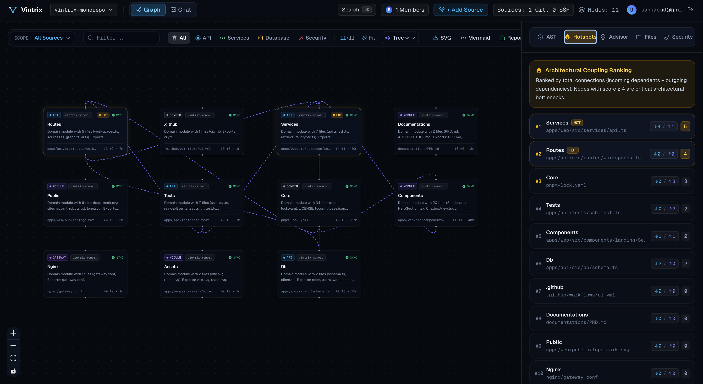

<div align="center">

# 🌐 VINTRIX
### Codebase Knowledge Graph & Architecture Intelligence Platform

[](https://github.com/novintriantonius/vintrix/actions)
[](LICENSE)
[](https://bun.sh)
[](https://react.dev)
[](https://www.typescriptlang.org)

<br />



<br />

**Vintrix** transforms complex, multi-repository and monolithic codebases into interactive, queryable **Knowledge Graphs**. Built on high-performance AST parsing, hybrid BM25 + Vector retrieval, and an intuitive graph canvas interface, Vintrix enables engineering teams to understand architecture, navigate dependencies, and interrogate codebases with LLM-powered context awareness.

[Key Features](#-key-features) • [Architecture](#-architecture) • [Getting Started](#-getting-started) • [Deployment](#-deployment) • [Security & Privacy](#-security--privacy)

</div>

---

## ✨ Key Features

- 🕸️ **Interactive Knowledge Graph Canvas**: Visual node-link diagram powered by React Flow with custom AST-aware nodes (Functions, Classes, Interfaces, Modules, Routes).
- ⚡ **Ultra-Fast AST Code Scanning**: In-memory TypeScript/JavaScript AST symbol parser extracting structural relationships, call hierarchies, and imports without slow external tooling.
- 🔍 **Hybrid BM25 & Semantic Retrieval**: Precision search merging lexical BM25 ranking and semantic vector distance for hyper-accurate AI context retrieval.
- 💬 **Context-Aware AI Chat & Code Explainer**: Built-in conversational assistant that queries the codebase knowledge graph directly to answer architectural questions with exact source code references.
- 🔄 **Multi-Source Code Ingestion**:
  - Direct Git integration (GitHub, GitLab, self-hosted Git over HTTPS or SSH).
  - Remote SSH / SFTP server syncing with AES-256 encrypted credential storage.
  - Multi-workspace workspace isolation for teams and organizations.
- 👥 **Team Collaboration & Cryptographic One-Time Invites**:
  - Role-Based Access Control (`owner`, `admin`, `member`, `viewer`).
  - Cryptographically secure one-time invite links with automatic 48-hour expiration.
- 🛡️ **Enterprise Security & Privacy**:
  - Zero permanent code exposure — credentials and SSH keys encrypted at rest via AES-256-GCM.
  - Granular RBAC and completely self-hostable via Docker Compose.

---

## 🏛 Architecture

```
┌────────────────────────────────────────────────────────────────────────┐
│                              FRONTEND                                  │
│   React 18 SPA + Vite + Tailwind CSS + Lucide Icons + React Flow       │
│   (Interactive Graph Canvas, History Replay Bar, Sliding Code Viewer)  │
└───────────────────────────────────┬────────────────────────────────────┘
                                    │ HTTP REST / SSE Stream
                                    ▼
┌────────────────────────────────────────────────────────────────────────┐
│                        BACKEND (Bun + ElysiaJS)                        │
│                                                                        │
│  ┌────────────────┐  ┌──────────────────┐  ┌────────────────────────┐  │
│  │  Auth & RBAC   │  │ Workspaces & Git │  │ AI Context & Retrieval │  │
│  │ (JWT + bcrypt) │  │  (SSH / Syncer)  │  │   (BM25 Hybrid RAG)    │  │
│  └───────┬────────┘  └────────┬─────────┘  └───────────┬────────────┘  │
│          │                    │                        │               │
└──────────┼────────────────────┼────────────────────────┼───────────────┘
           │                    │                        │
           ▼                    ▼                        ▼
    ┌──────────────┐     ┌──────────────┐         ┌──────────────┐
    │  PostgreSQL  │     │  Local AST   │         │ Custom / BYO │
    │ (Drizzle ORM)│     │ Cache & Git  │         │  LLM Engine  │
    └──────────────┘     └──────────────┘         └──────────────┘
```

---

## 🚀 Getting Started

### Prerequisites

- **[Bun](https://bun.sh/)** v1.1.0 or higher (or **Node.js** v20+)
- **[pnpm](https://pnpm.io/)** v9+
- **[Docker](https://www.docker.com/)** and **Docker Compose** (for PostgreSQL and production deployment)

### 1. Clone Repository

```bash
git clone https://github.com/novintriantonius/vintrix.git
cd vintrix
```

### 2. Environment Setup

Copy example environment variables:

```bash
# Root & Production environment
cp .env.example .env

# Backend API environment
cp apps/api/.env.example apps/api/.env
```

Generate secure keys for encryption and JWT:
```bash
# Generate 32-character encryption key and JWT secret:
openssl rand -base64 32
```
Update `ENCRYPTION_MASTER_KEY` and `JWT_SECRET` in `apps/api/.env`.

### 3. Install Dependencies

```bash
pnpm install
```

### 4. Run Development Stack

Start the PostgreSQL database service:
```bash
docker compose up -d postgres
```

Run database schema migration:
```bash
pnpm --filter @vintrix/api db:push
```

Start both API and Web frontend concurrently:
```bash
# Start backend API (http://localhost:3001)
pnpm --filter @vintrix/api dev

# Start frontend web app (http://localhost:5173)
pnpm --filter @vintrix/web dev
```

Visit **`http://localhost:5173`** in your browser.

---

## 🧪 Testing

Run automated unit and integration tests across services:

```bash
# Test API and AST services
pnpm --filter @vintrix/api test

# Typecheck and build frontend
pnpm --filter @vintrix/web build
```

---

## 🐳 Production Deployment

Vintrix provides an idempotent, zero-downtime rolling update deployment script with Docker Compose:

```bash
chmod +x deploy.sh
./deploy.sh
```

Or run directly with Docker Compose:

```bash
docker compose up -d --build
```

The gateway reverse proxy will serve the application on port **80** (or `PORT` specified in `.env`).

---

## 🔒 Security & Privacy

- **No Plaintext Secrets**: Sensitive remote server keys and credentials are encrypted using AES-256-GCM authenticated encryption before saving into database tables.
- **Single-Use One-Time Tokens**: Workspace invitation links utilize cryptographically random 32-byte tokens (`crypto.randomBytes(32)`), expire in 48 hours, and are invalidated immediately upon first use.
- **Repository Data**: Repositories synchronized via Git/SSH are strictly stored in local volatile caches and never redistributed or sent to third-party tracking services.

---

## 📄 License

This project is licensed under the **MIT License** — see the [LICENSE](LICENSE) file for details.
